# Tested visuals. 2026-10-22

Thirteen images generated in this ChatGPT conversation: eight initial tests and five retests after prompt revisions. “Tested” means generated and visually reviewed once for that prompt version. It does not mean every criterion passed or that the founder approved publication.

The exact submitted prompts and YAML snapshots are alongside each image. The [manifest](manifest.json) records dimensions, hashes, versions, review outcomes, and execution limits. The tool did not expose an exact model ID or seed.

These are full-dimension WebP review copies exported from the generated PNGs at quality 95. No cropping, resizing, or retouching was applied. Requested aspect ratios are not guarantees of exact pixel ratios.

## Review summary

| Example | Initial review | Retest review |
|---|---|---|
| editorial character dark | revise | partial |
| facade brutalist dusk | minor_revision | pass_with_caveat |
| hero shot tech product | minor_revision | pass_with_caveat |
| jacket editorial contrast | pass_with_caveat | Not needed for this review |
| jewelry gold editorial | pass_with_caveat | Not needed for this review |
| shoe luxury minimal | pass_with_caveat | Not needed for this review |
| texture charcoal gold | revise | pass_with_caveat |
| watch dark studio premium | minor_revision | pass_with_caveat |

## Visuals

### editorial character dark-initial

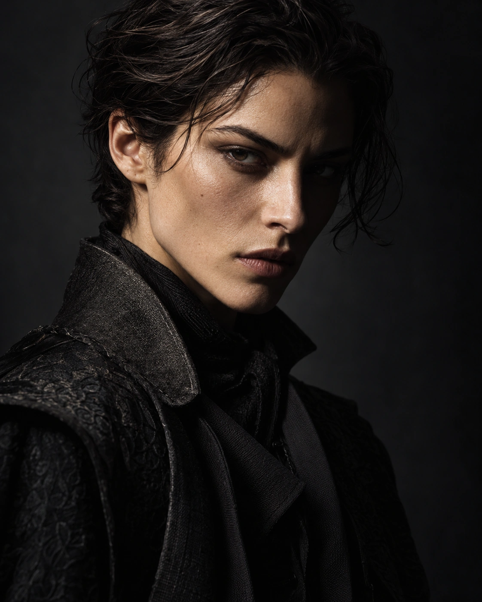

Good skin and fabric detail. Split and Rembrandt instructions conflict; clear enclosed triangle not visible.

[Exact prompt](editorial_character_dark-initial-prompt.txt) · [YAML snapshot](editorial_character_dark-initial-source.yaml)

### facade brutalist dusk-initial

Concrete and composition follow the brief. Unrequested architectural uplights were added.

[Exact prompt](facade_brutalist_dusk-initial-prompt.txt) · [YAML snapshot](facade_brutalist_dusk-initial-source.yaml)

### hero shot tech product-initial

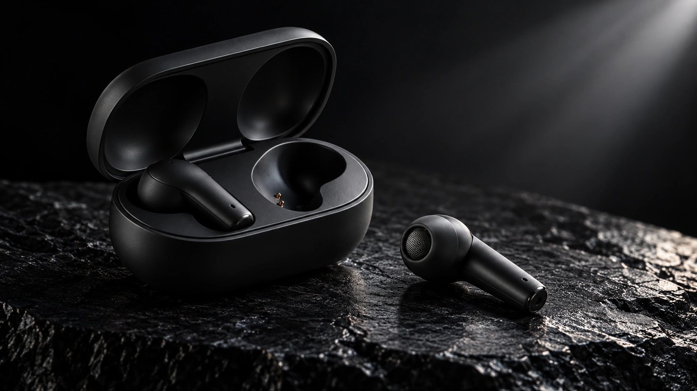

Two earbuds and strong product staging. Lid appears more open than requested.

[Exact prompt](hero_shot_tech_product-initial-prompt.txt) · [YAML snapshot](hero_shot_tech_product-initial-source.yaml)

### jacket editorial contrast-initial

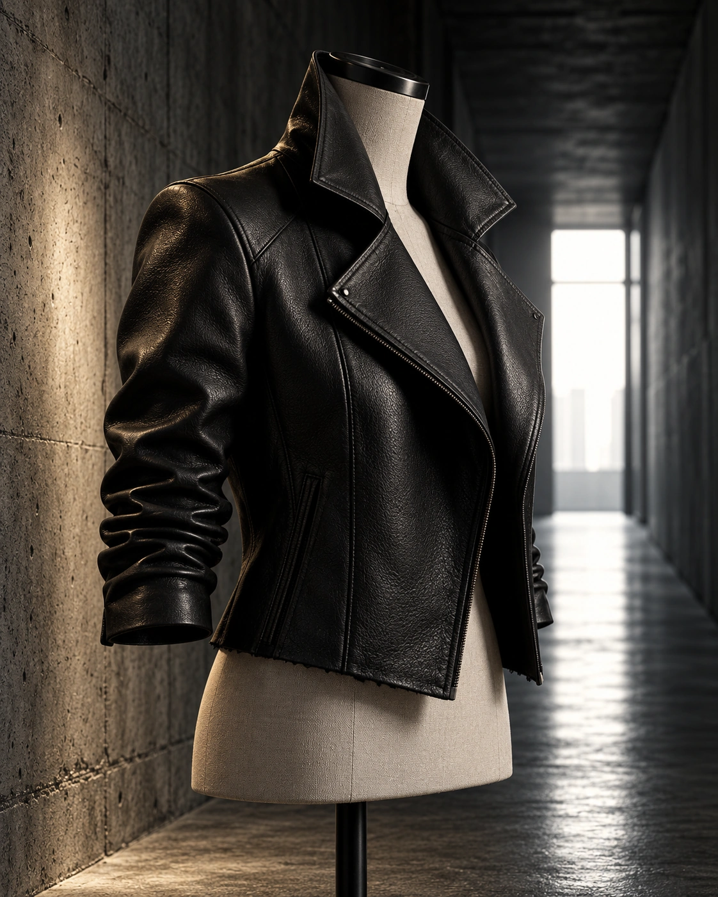

Strong leather texture and mannequin staging. Exact 45-degree orientation and sleeve position are approximate.

[Exact prompt](jacket_editorial_contrast-initial-prompt.txt) · [YAML snapshot](jacket_editorial_contrast-initial-source.yaml)

### jewelry gold editorial-initial

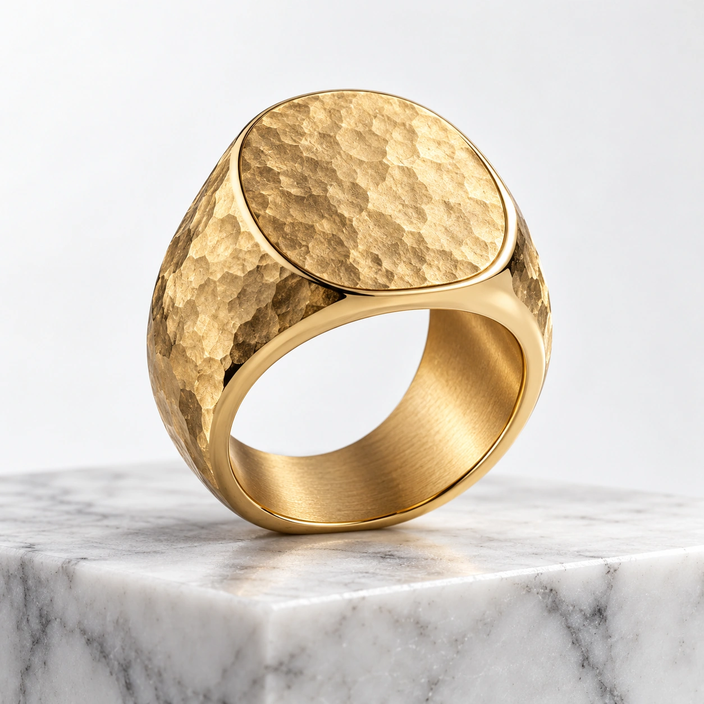

Hammered metal, polished edges and marble staging match. Gold purity cannot be verified visually; exact tilt is approximate.

[Exact prompt](jewelry_gold_editorial-initial-prompt.txt) · [YAML snapshot](jewelry_gold_editorial-initial-source.yaml)

### shoe luxury minimal-initial

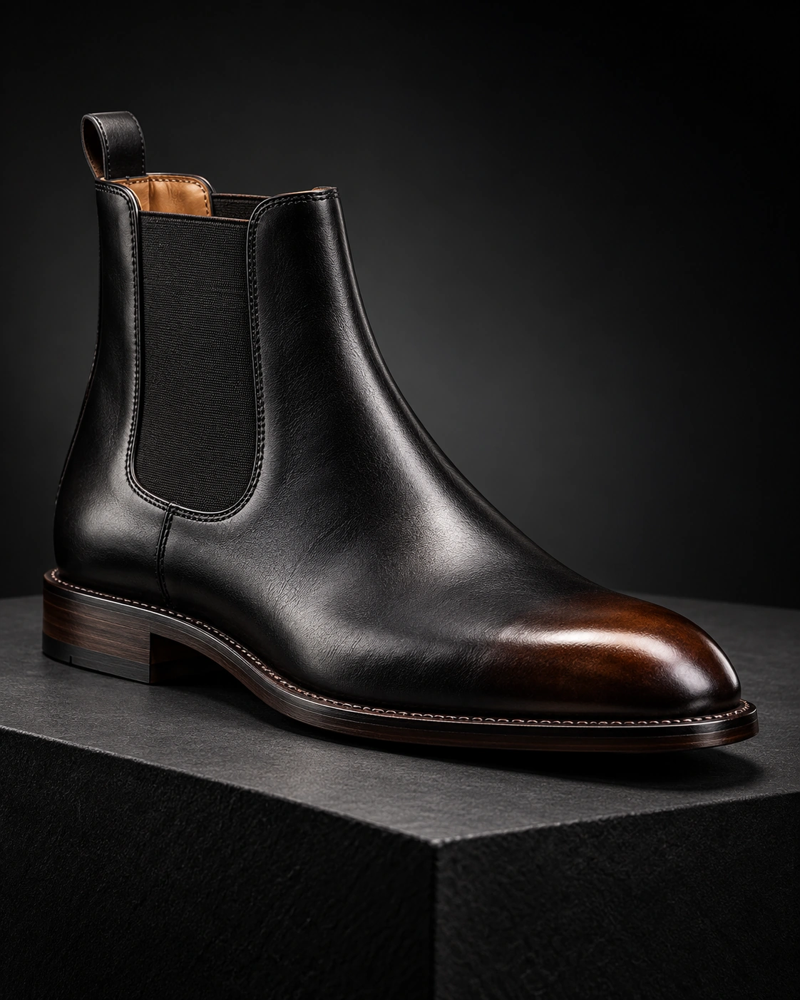

Boot, elastic panel, stitching and plinth match. Burnished toe has a brown cast; manufacturing construction cannot be verified.

[Exact prompt](shoe_luxury_minimal-initial-prompt.txt) · [YAML snapshot](shoe_luxury_minimal-initial-source.yaml)

### texture charcoal gold-initial

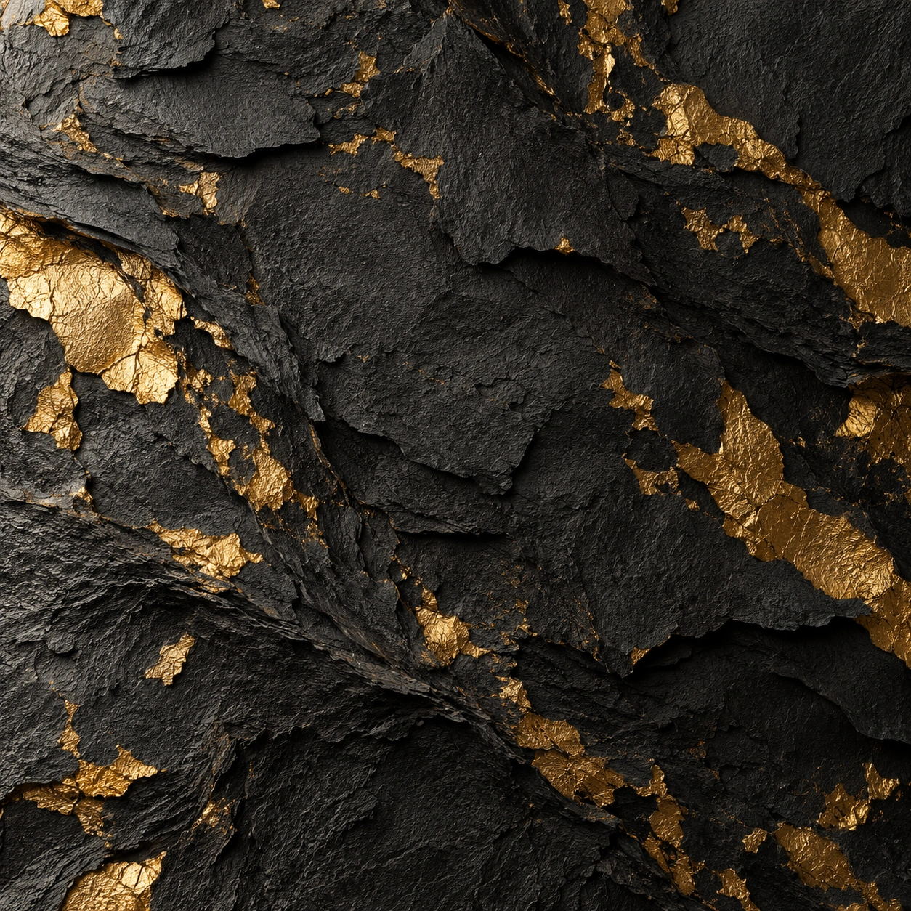

Attractive gold accents, but thick charcoal layers read as slate rather than paper.

[Exact prompt](texture_charcoal_gold-initial-prompt.txt) · [YAML snapshot](texture_charcoal_gold-initial-source.yaml)

### watch dark studio premium-initial

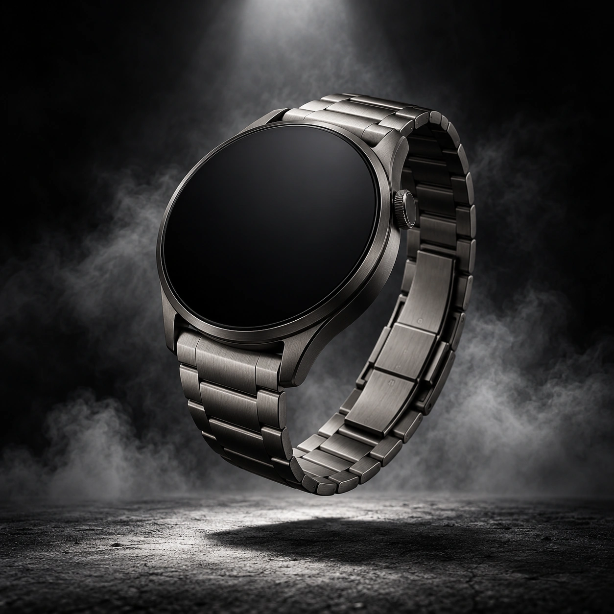

Strong metal rendering and floating staging; bracelet forms a closed loop.

[Exact prompt](watch_dark_studio_premium-initial-prompt.txt) · [YAML snapshot](watch_dark_studio_premium-initial-source.yaml)

### editorial character dark-retest

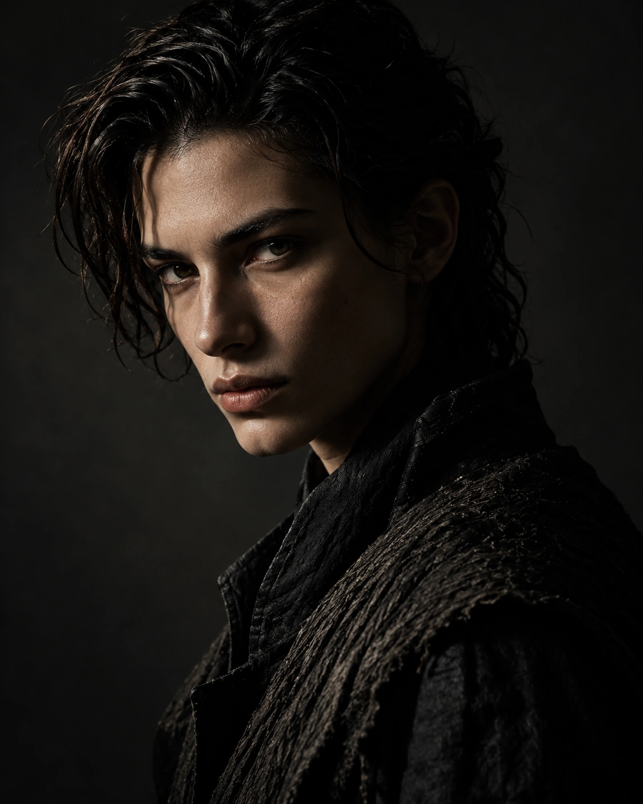

Conflicting setup removed. Portrait is strong, but the precise enclosed Rembrandt triangle remains unclear. New fictional face; identity consistency was not tested.

[Exact prompt](editorial_character_dark-retest-prompt.txt) · [YAML snapshot](editorial_character_dark-retest-source.yaml)

### facade brutalist dusk-retest

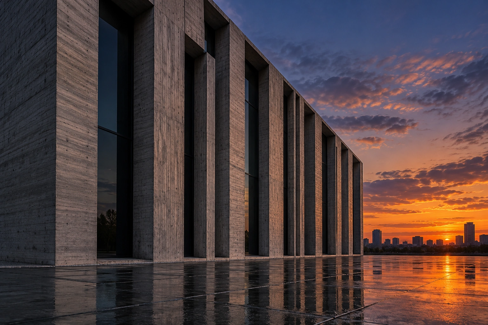

Unrequested uplights removed. Dusk and wet pavement remain; exact left two-thirds placement is approximate.

[Exact prompt](facade_brutalist_dusk-retest-prompt.txt) · [YAML snapshot](facade_brutalist_dusk-retest-source.yaml)

### hero shot tech product-retest

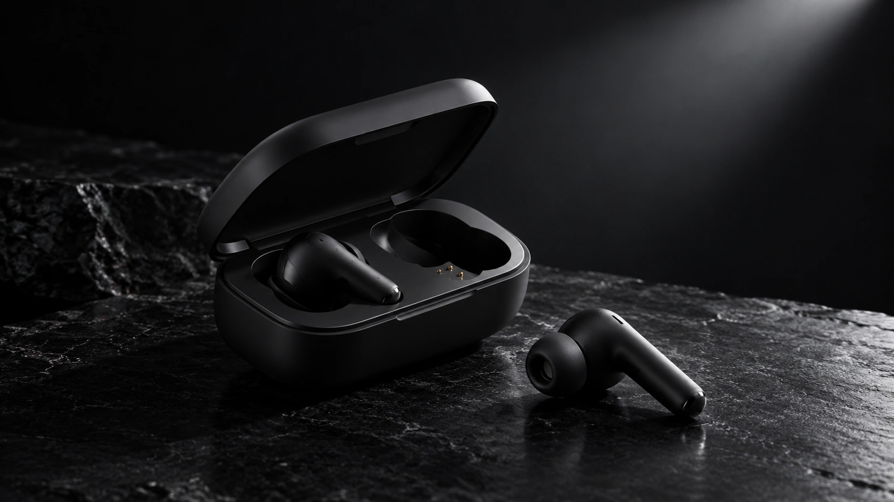

Lid opening is closer to the brief. Angle is visually approximate, not geometrically measured.

[Exact prompt](hero_shot_tech_product-retest-prompt.txt) · [YAML snapshot](hero_shot_tech_product-retest-source.yaml)

### texture charcoal gold-retest

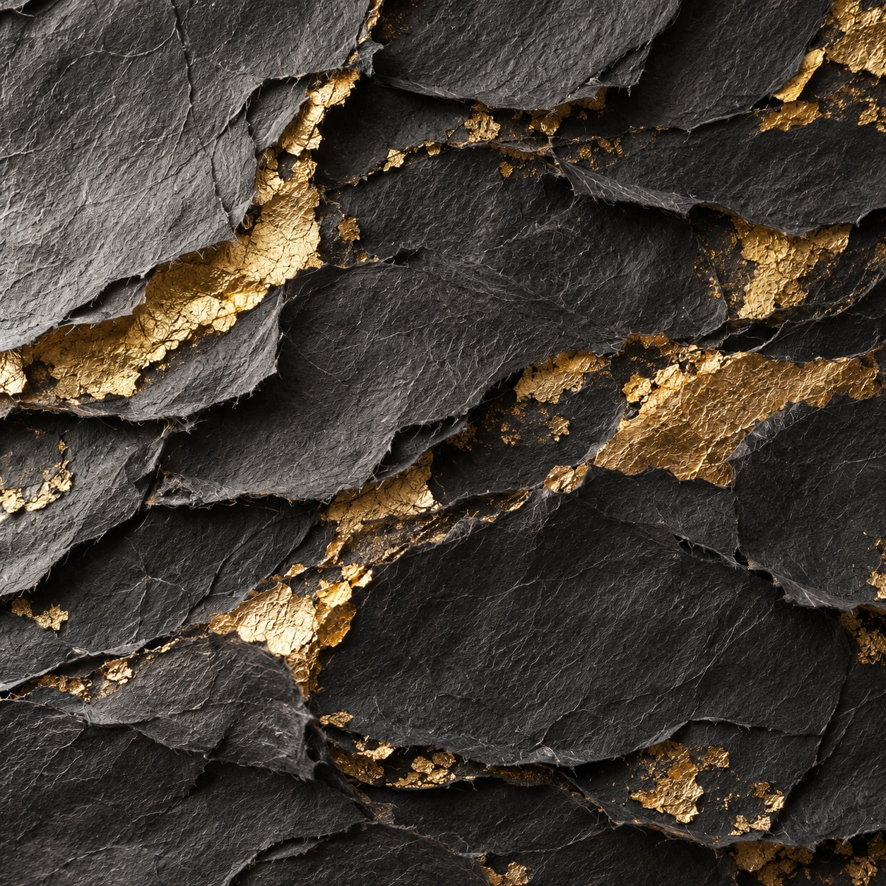

Thin torn layers and visible fibers now read as paper. No seamless tile or print test performed.

[Exact prompt](texture_charcoal_gold-retest-prompt.txt) · [YAML snapshot](texture_charcoal_gold-retest-source.yaml)

### watch dark studio premium-retest

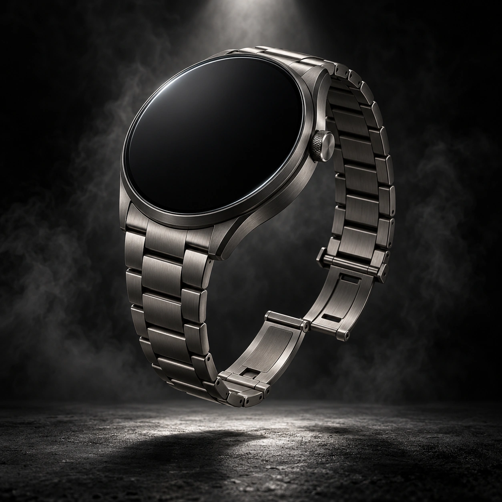

Open deployant clasp and separated ends are visible. Exact angle, mechanics and material specification are not independently verified.

[Exact prompt](watch_dark_studio_premium-retest-prompt.txt) · [YAML snapshot](watch_dark_studio_premium-retest-source.yaml)

## Limits

Review covers visible appearance, composition, lighting, materials, and exclusions. It does not prove product mechanics, material purity, output consistency, intellectual-property clearance, or suitability for a particular client. Engine overrides and named variants have not been rendered.
